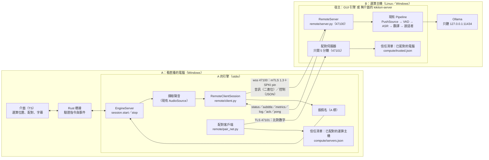
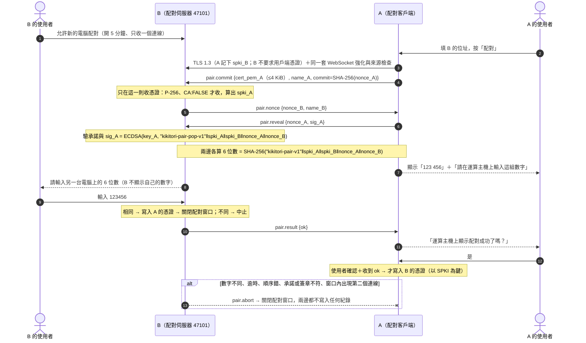
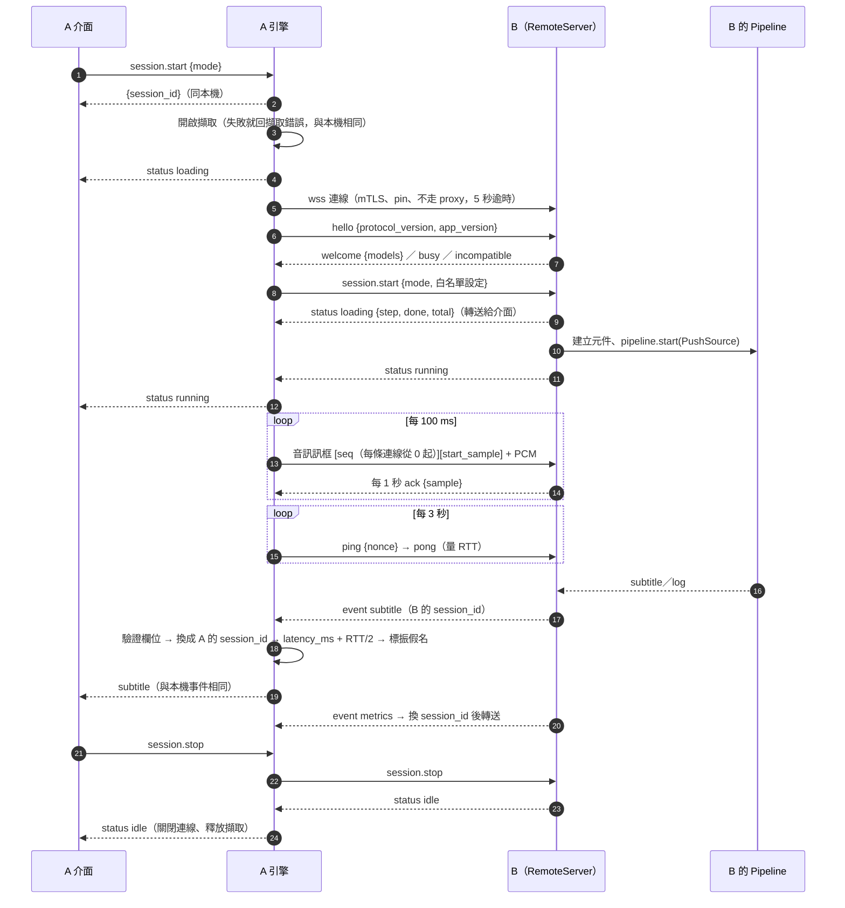
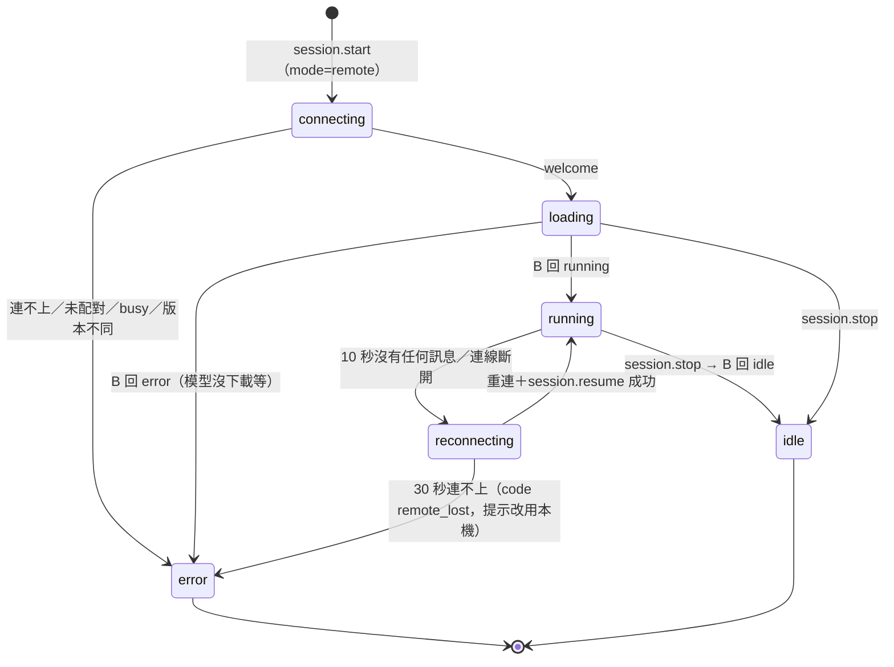
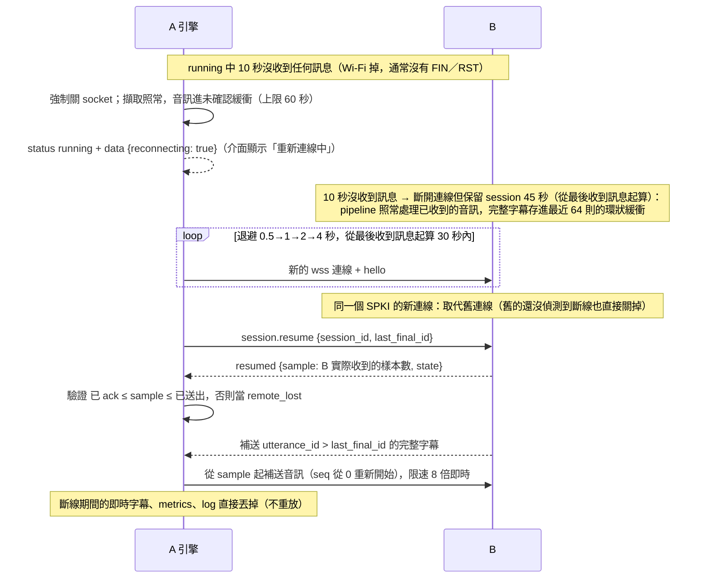

# 規格：遠端運算（聲音與字幕在本機，辨識與翻譯在另一台電腦）

狀態：使用者已確認（2026-11-09：一對一連線、跨網段用 Tailscale、資安以近年事件為參考；新增 `websockets==17.4`、`cryptography==50.0.2`）。研究依據：[reports/kikitori 遠端運算架構.md](../../reports/kikitori%20遠端運算架構.md)。

## 目標

- **情境**：使用者有一台跑得動大模型的電腦 B（例如有 RTX 顯示卡的桌機），另一台電腦 A 用來看直播（筆電、沒有好顯示卡）。在 A 填入 B 的位址，A 擷取聲音、顯示字幕，語音辨識與翻譯在 B 上跑。
- **成功條件**：
  - 有線或 5 GHz Wi-Fi 的區網上，A 的「說完到完整字幕」延遲比 B 本機執行多不到 0.1 秒；即時字幕照常出現。
  - 字幕、匯出的 SRT 時間、說話者標籤、振假名、術語表、原文校正、本場資訊，在遠端模式與本機模式的行為相同。
  - 沒有配對過的電腦連不上 B；A 與 B 之間的聲音與文字全程加密。
  - Wi-Fi 斷一下（幾秒）字幕會接續，不重複、不漏句；斷太久會清楚提示，可以改回本機。
- **非目標（這一版不做）**：跨網際網路的 Opus 壓縮、mDNS 自動找主機、QUIC、多人同時共用一台 B 的排程最佳化（研究報告的階段 5–7）。跨網際網路先用 Tailscale 等虛擬區網，當成區網使用。

## 架構

**在擷取之後切開：A 只擷取聲音並持續送出，B 用現有、不改動的 `Pipeline`（VAD 切句、即時／完整路徑、翻譯、說話者標籤）處理，再把現有的引擎事件送回 A。**

- **A（本機）**：擷取聲音 → 經加密連線持續送給 B → 收到 `subtitle`／`metrics`／`status` 事件，振假名在 A 標上後交給介面。
- **B（運算主機）**：把收到的音訊當成一個聲音來源（`PushSource`）交給現有的 `Pipeline`；模型組合用 B 自己的（B 的硬體決定）。
- 研究報告建議「A 做 VAD、只送語音段」以省頻寬；這版改在 B 做 VAD，理由（2026-11-09 決定）：
  - **重用最多**：B 跑的就是已測過的同一套 pipeline，即時／完整字幕的行為保證與本機相同；不必把 `Pipeline` 的生命週期（三條執行緒、停止、錯誤）拆成兩半。
  - **時間軸天然一致**：B 收到的樣本數 = A 送出的樣本數，`start_sample`、SRT 時間不必換算。
  - **頻寬不是問題**：16 kHz int16 是 256 kbit/s，區網與 Tailscale 都綽綽有餘；VTuber 直播幾乎一直有 BGM，A 端 VAD 能省下的靜音本來就少。跨網際網路要省頻寬時再加 Opus 與 A 端 VAD（研究報告階段 6）。
- **`latency_ms`**：B 量「句尾判定 → 送出完整字幕」，A 再加上量到的單程時間（RTT/2）。
- **振假名**只需要文字，留在 A 標（不必在 B 下載辭典）。
- **B 同時只服務一個對象**：B 自己在跑字幕時拒絕遠端連線（`busy`），遠端連線中 B 的「開始」也不能按（同一張 GPU 不能載兩份模型）。

## 協定（A ↔ B）

- **傳輸**：一條長連線，WebSocket over TLS（`wss://`），預設埠 47100。訊息分兩種：
  - **JSON 文字訊息**：控制與字幕（與現有引擎協定同樣的命名風格）。
  - **二進位訊息**：音訊，`[seq u32][start_sample u64]` 標頭加上 16 kHz int16 PCM，約每 100 ms 一則。區網 256 kbit/s，頻寬不是問題（報告「傳輸」一節）。
- **握手**：`hello {protocol_version, app_version, capabilities}` → B 回 `welcome` 或 `busy`／`incompatible`。
- **session**：`session.start {mode, 語言, 翻譯開關, 術語表, 原文校正, 本場資訊, 說話者標籤}`；B 用**自己的**模型組合（B 的硬體決定），回 `session.started {models}`。
- **事件**：A → B：音訊（連續，二進位訊息）、`session.stop`；B → A：`status`（loading／running／idle／error，含載入進度）、`subtitle` 與 `metrics`（與現有引擎事件相同欄位）、`ack {sample}`（已收到到哪裡）、`log`。
- **執行中切換**：`session.set_translation`（與本機相同）。
- **心跳**：每 3 秒 `ping`／`pong`（順便量 RTT），10 秒沒有回應判定斷線。

## 安全（階段 1–2）

依據：`research_notes/kikitori 遠端運算架構/security_advisories_threat_model.md`（近年 CVE 與資安事件、20 項威脅對照、37 個安全測試）。
原本「6 位數配對碼對雙方指紋做 HMAC」會被配對當下的中間人離線試完 100 萬組碼（Sunshine CVE-2024-51738、RFC 8446 §2.2），**已改用兩邊比對數字**（2026-11-09 使用者決定）。

### 身分與配對

- 每台電腦第一次啟用遠端功能時產生自己的自簽憑證（ECDSA P-256，`BasicConstraints(ca=False)`，不能拿來簽別的憑證——Sunshine GHSA-6jvv）。私鑰與信任清單只有本人可讀，不進診斷資訊或 log。
- **配對（兩邊比對數字，類似藍牙 Numeric Comparison）**：
  1. 使用者在 B 按「允許新的電腦連線」→ B 開放**配對埠**（主埠 + 1，預設 47101）5 分鐘；同時只接受一個待配對連線（Sunshine GHSA-36ff）。
  2. A 填 B 的位址按「配對」→ 兩端用 TLS（雙方出示自己的憑證、還不驗證對方）連上，交換：A 先送 `commit = SHA-256(nonce_A)`，B 再送 `nonce_B`，A 最後公開 `nonce_A`（先承諾後公開，中間人無法事後挑選亂數）。
  3. 兩邊各自算 `SHA-256("kikitori-pair-v1" ‖ spki_A ‖ spki_B ‖ nonce_A ‖ nonce_B)` 取 6 位數顯示；**使用者看兩台螢幕的數字相同，兩邊都按「確認」**才算成功。中間人要讓兩邊數字一樣只有百萬分之一的機會，而且每次失敗都要使用者重新開始。
  4. **只在兩邊都確認之後**才各自寫入對方的 SPKI（CVE-2024-45407：配對失敗不得留下任何信任紀錄，寫成測試）。任何一步順序錯、逾時、使用者按「不一樣」→ 中止並關閉配對埠。
- **連線**：主埠只接受 TLS 1.3、**一定要出示用戶端憑證**；握手後比對葉憑證的 SPKI 雜湊必須與信任清單完全相同（不把對方憑證當成信任根）。未配對的電腦在交換任何應用層訊息之前就被斷開。不用 raw public key、不開 OCSP。
- **移除**：B 的已配對清單可以移除；移除時立刻斷線並重建 TLS 設定。

### 網路暴露面

- **預設關閉**：`compute.server_enabled` 預設 false；開啟要使用者在 B 上明確操作。
- **只接受私有網段的來源**：RFC 1918、IPv6 ULA、link-local、Tailscale 的 100.64.0.0/10 與 `fd7a:115c:a1e0::/48`；其他來源 IP 在 TLS 握手之後、HTTP 升級之前回 403（`websockets` 在每條連線的執行緒裡做 TLS 握手，沒有更早的掛鉤；沒配對的憑證本來就過不了雙向 TLS，這一層是額外的保險）。跨網段請用 Tailscale（至少 1.104.4），**不要用 Funnel**、不要開路由器埠轉發（TS-2024-005：tailnet IP 不能當身分，所以仍要配對與雙向 TLS）。
- **Ollama 維持只聽 `127.0.0.1`**，由 B 的引擎代為呼叫；說明文件提醒不要自己把 Ollama 改成 `0.0.0.0`（Probllama CVE-2024-37032、大量暴露在網路上的 Ollama）。

### 協定與資源

- **B 只認得固定幾種訊息**（`remote/protocol.py`：hello、session.start／stop、set_translation、ping、音訊）。B 端**不能**沿用 stdio 引擎的指令分派表——那裡有 `models.pull_translation`、`models.delete`、`settings.set` 等。
- **`session.start` 設定白名單**：語言、翻譯開關、術語表、原文校正、本場資訊、說話者標籤、切句時間；翻譯伺服器網址、模型、金鑰環境變數、ASR、遠端設定一律拒絕（否則能讓 B 把 API 金鑰送到別處或載入任意模型）。合併後照本機設定規則再驗證一次。
- **WebSocket（`websockets` 17.4）**：關掉 permessage-deflate（壓縮炸彈）、不送 `Server` 版本標頭、**只接受沒有 `Origin` 標頭的連線**（瀏覽器一定帶 Origin，跨站 WebSocket 劫持因此被擋）、檢查 `Host`、單則訊息上限（文字 512 KiB、音訊 1 秒）、握手逾時 5 秒、閒置逾時、不用 `recv_streaming()`；A 端不走系統 proxy。
- **音訊訊框先驗再處理**：長度大於 0 且為偶數、`seq` 遞增、`start_sample` 與已收到的樣本數連續；B 的音訊緩衝有上限，滿了讓 session 失敗而不是悄悄丟資料。
- **只用 JSON 與固定格式的二進位**：不用 pickle、`eval`，不用字串去查要呼叫的方法。
- **A 把 B 的回傳當不可信輸入**：先驗證格式再轉成現有的 `subtitle` 事件（Rust 與 TS 端原本的驗證照舊）；介面維持不用 `innerHTML`；B 不能觸發 A 的任何指令（Open WebUI CVE-2025-64496 的教訓）。
- **log 不記**音訊、字幕文字、術語表、配對數字、金鑰。
- **開發用的明文連線**只能綁 127.0.0.1、每次啟動產生 token，正式建置無法開啟（MCP Inspector CVE-2025-49596）。

### Tauri 端

- 新的指令只加進主視窗的 capability（`main.json`），加測試確認 overlay 沒有；CSP 不加任何網路位址（連線在 Python 引擎之間，網頁不碰網路）；Rust 端再驗一次主機、埠、確認動作的格式。

## 斷線與重連（階段 3）

- A 在記憶體保留 60 秒還沒被 B `ack` 的音訊；重連後帶 `resume_from_sample` 補送，B 保留 session 30 秒。
- 斷線期間字幕列顯示「與運算主機的連線中斷，重新連線中」；超過 30 秒仍連不上，提示「改用這台電腦處理」（一鍵切回本機）。
- 已送出的完整字幕不重送；B 依 `utterance_id` 去重。

## 設定與介面

- **新設定 `compute`**（不升 schema，缺少時用預設）：
  - `compute.mode`：`"local"`（預設）或 `"remote"`。
  - `compute.host`：B 的位址（IP 或主機名稱），`compute.port`：要連的 B 的埠，預設 47100。
  - `compute.server_enabled`：這台電腦是否接受其他電腦連線（B 端），預設關閉。
  - `compute.listen_host`／`compute.listen_port`：這台當 B 時監聽的位址與埠（配對埠＝監聽埠＋1，所以最大 65534）。`listen_port` 與 `port` 分開（2026-11-20）：同一台電腦連別台與被別台連的埠可以不同。舊設定檔沒有 `listen_port` 時沿用 `port`（當時兩者共用），`port` 是 65535 時用預設值。
  - 已配對清單與本機憑證存在設定資料夾的 `compute/`（不放進 settings.json，診斷資訊不包含）。
- **角色三選一**（2026-11-20，使用者要求「非資工背景也看得懂」）：左側欄「運算位置」改成「只用這台電腦」（local）／「用另一台電腦處理」（A）／「讓別台電腦用這台處理」（B）。角色由設定推得：`server_enabled` → B，否則看 `mode`。選 B 等於 `remote.server_set {enabled: true}`，引擎同時把 `mode` 設成 `local`（這台自己用時在本機運算，GPU 由使用權共用）；選另外兩個先關掉提供運算。主要選項不出現 server／IP／埠等字眼；監聽位址只有一個時自動選，多個時以「這個網路（家裡或公司）」「Tailscale（不在同一個地方也能連）」標示。
- **A 端**：左側欄顯示主機與延遲；設定頁「遠端運算」區填位址、配對。遠端模式下不提醒本機的推薦組合與 GPU 加速元件，選說話者標籤也不在 A 下載說話者模型（在 B 跑；無介面主機的「準備模型」一律備好說話者模型）。
- **B 端**：設定頁「提供運算給其他電腦」開關（與角色同步）、配對碼、已配對的電腦、目前連線中的電腦、「重建這台電腦的身分」。
- 模型頁：遠端模式時顯示「模型在運算主機上」，不要求 A 下載辨識模型。

## 實作設計與規格圖（T7–T12，2026-11-20）

T1–T6（設定、`PushSource`、協定、身分、配對邏輯、B 端伺服器）已完成。這一節是剩下部分的設計，實作前先經過審查（見「設計審查」）。

### 元件圖



### 配對時序（A 顯示數字、B 輸入數字）



- **為什麼 B 要輸入、不是按「確認」**（審查第 4 點）：區網上任何人都能在 5 分鐘內搶先連上配對埠，B 照樣會顯示一組數字；使用者習慣按確認（或在終端機打 `y`）就讓攻擊者配對成功。輸入 A 螢幕上的數字逼使用者真的比對。
- **為什麼 A 還要使用者確認**：`pair.result` 是 A 的 TLS 對端送的，中間人也能送；只有使用者看到 B 上的「配對成功」才能證明 A 連到的是真的 B。
- **A 的憑證在訊息裡送**：Python 的 `ssl` 無法「要求用戶端憑證但不驗證」，B 端用 `CERT_NONE`。B 的金鑰由 TLS 握手證明；數字綁的是兩邊實際看到的 SPKI，中間人換掉任一邊就不同。`sig_A` 證明 A 持有私鑰（約 10 行）。憑證**只能**在 `pair.commit` 出現：B 送出 nonce 之後才給憑證的話，攻擊者能試百萬把金鑰湊出相同數字。
- 配對窗口佔用期間又有連線進來：全部中止並關窗，提示「有多台電腦同時嘗試配對」。每一步 10 秒逾時、等使用者 120 秒。
- B 已寫入而 `pair.result` 沒送到 A：B 單邊信任，無害（A 連不上，重新配對會覆蓋同一個 SPKI）。
- **兩邊的信任清單都以 SPKI 為鍵**（重用 `TrustStore`）：B 的 `compute/trusted.json`、A 的 `compute/servers.json`；位址只是顯示用的提示。A 連線時 `CERT_REQUIRED`（已配對主機的憑證當信任錨）、`check_hostname=False`，握手後葉憑證的 SPKI 必須在清單上。換位址（區網 ↔ Tailscale）不必重新配對。

### 一場遠端字幕的時序



### A 端的執行緒與狀態



- 執行緒（兩端相同的原則，審查第 2 點）：`websockets` 同步 API 的 `send` 平常**沒有逾時**（`sendall` 在 `protocol_mutex` 裡可以無限期卡住，`close()` 也要同一把鎖），所以：
  - **單一寫入執行緒＋有上限的送出佇列**：其他執行緒只把訊息放進佇列，不直接 `send`。佇列滿（A：未送出的音訊超過 5 秒；B：待送訊息超過 256 則）視為連線壞掉。
  - **看門狗**：寫入卡住超過 5 秒，或 10 秒沒收到任何訊息，直接 `socket.shutdown()／close()` 強制中斷（不用 `connection.close()`），讓 `recv` 與寫入都立刻返回。
  - A：**擷取**（讀聲音 → 切成 ≤100 ms 訊框 → 放進未確認緩衝與送出佇列）、**寫入**、**接收**（`recv` → `parse_server` → 分派）、**心跳**（每 3 秒放一則 ping）。
  - B：pipeline 的 `on_subtitle`、`MetricsReporter` 只放進佇列，不在 worker 執行緒上碰網路。
- **停止**（審查第 11 點）：`stop(timeout)` 送 `session.stop` → 最多等 2 秒 B 回 `idle` → 強制關 socket → join 接收與寫入執行緒 → 引擎才送 `status idle`（之後不會再冒出字幕）。連線中或重連中也能停：A 自己用 `socket.create_connection` 建 socket 再以 `sock=` 交給 `connect`，停止時關掉它。總時間有上限（stdio 請求執行緒會呼叫它）。
- 對引擎的介面 `RemoteClientSession`：`start(source)`、`stop(timeout)`、`set_translation_enabled(enabled)`、`state`、`error`、`wait(timeout)`，回呼 `on_event(name, data)`、`on_status(state, detail, code, data)`。引擎的 `_load_session` 在 `compute.mode == "remote"` 時改走 `_load_remote_session`：不呼叫 `build_components`、不檢查本機翻譯模型、不跑本機 `MetricsReporter`（metrics 來自 B）。
- **B 的回傳一律當不可信**：`status` 的 `code` 用白名單、`detail` 限 500 字、`data` 只收 `{step, done, total}`；subtitle 在 A 先驗證型別與長度（`original`／`translation` 字串 ≤ 4000 字、樣本位置是非負整數且不超過 A 已送出的樣本數、`voice` 1–64）再轉送；不合格的那則丟掉並記 warning，連續太多則中止。
- 錯誤碼（A 端新增，介面翻譯）：`remote_unreachable`、`remote_not_paired`（握手被拒或 B 的憑證不在信任清單）、`remote_busy`、`remote_incompatible`、`remote_lost`、`remote_model_not_downloaded`（B 回 `model_not_downloaded`，提示到 B 下載，不能觸發 A 的下載）、`remote_error`（B 的其他錯誤，detail 照轉）、`remote_identity_error`（本機憑證讀不到，要使用者明確重設）、`remote_pairing_closed`（B 沒有開配對窗口或已過期）。

### 斷線重連（T11）



- **為什麼保留 session 而不是重連就開新的一場**（審查 (c)）：開新的一場會重設 B 的翻譯前文與說話者分群（違反「說話者標籤與本機相同」），還要重新載入、預熱模型。保留 session 只多一個環狀緩衝與一則訊息。
- **B 的 session 移到 `RemoteServer` 層**（審查第 3 點，T11 的第一步）：擁有者 SPKI、可替換的輸出端（新連線接手）、保留計時器；現在 `_Session` 綁在 `_handle` 的區域變數與連線閉包上。
- **同一個 SPKI 的新連線取代舊連線**（審查第 1 點）：否則 A 10 秒就重連，B 卻要等舊連線逾時才放開 GPU，自己把自己擋成 `busy`；「停止後立刻再開始」也是同一個情況。不同 SPKI 才回 `busy`。
- B 只接受**同一個 SPKI**、在保留期間內、`session_id` 相符的 `session.resume`，否則回 `resume_failed`，A 改成 `error remote_lost`。斷線期間 pipeline 進入 error／idle 時記下最終狀態，續接時送出。
- 補送限速約 8 倍即時：`PushSource` 上限 30 秒，一口氣補送會溢位讓 session 失敗。
- 時間：A 從最後收到訊息起 10 秒判定斷線、30 秒放棄；B 從最後收到訊息起保留 45 秒（必須比 A 長）。驗收的「拔網路 40 秒」預期結果是 `remote_lost`＋一鍵改用本機。
- 斷線與保留期間 B 照樣持有 GPU 使用權：其他電腦連進來仍是 `busy`。

### B 的兩種宿主

- **GUI 引擎**：設定頁的「提供運算給其他電腦」開關 → 引擎方法 `remote.server_set {enabled}` 在引擎行程裡啟動 `RemoteServer`。GPU 使用權（審查第 10 點）：`acquire_gpu` 在 `_session_lock` 內檢查「沒有本機 session、上一個載入執行緒已結束、沒有正在釋放的元件」並設 `_serving_peer`；`_session_start` 在同一把鎖內檢查它（遠端進行中回 `session_active`）。遠端進行中 `models.delete`／`models.download` 的 ASR 模型與改 ASR 設定視為使用中；`engine.shutdown` 先停 `RemoteServer`。
- **無介面主機（`kikitori` 選單 →「運算主機」）**：給 alian_server 這種用 SSH 管理的 Linux 主機。互動選單（不靠參數）：
  1. 開始提供運算（前景執行；執行中仍可用按鍵進入配對、列出連線、斷開目前的電腦、`s` 看目前負荷，Ctrl+C 停止）
  2. 允許新的電腦配對（輸入另一台電腦上顯示的 6 位數）
  3. 已配對的電腦（列出／移除）
  4. 準備模型（依硬體建議設定模型並下載 ASR、說話者模型；翻譯模型用 Ollama 下載）
  5. 選擇模型（列出每個辨識模型需要的記憶體、跑不跑得動、是否已下載、建議與目前；換完整辨識模型，見 `docs/specs/compute-capacity.md`「六」）
  6. 變更監聽位址
  7. 重建這台電腦的身分
  8. 返回

  與 GUI 共用同一個設定資料夾與 `compute/`。啟動時顯示本機 SPKI 指紋；**不預設 `0.0.0.0`**（威脅模型筆記 §190）：第一次啟動列出這台電腦的私有網段與 Tailscale 位址讓使用者選，存進 `compute.listen_host`。「準備模型」重用引擎既有的建議與下載邏輯，不另寫一份。不做 systemd（見「尚未決定」）。

### 引擎方法、Tauri 指令與事件（T13 契約，2026-11-20 定案）

Python 引擎、Rust 橋接與介面三邊照這份實作；改動要三邊一起改。

**共用的值**

- `spki`：64 個小寫十六進位字元（SPKI SHA-256）。`fingerprint`：前 16 位元組，每 4 個十六進位字元一組、以空白分隔（例如 `05aa 3f39 4a53 9a23 62d9 a1e4 cd57 cba2`），給使用者核對用。
- `TrustedEntry`：`{spki, name, fingerprint, paired_at}`（`name` ≤ 64 字、`paired_at` 為 ISO 8601 UTC）。
- `PairingState`：`{role: "server"|"client", state, digits, peer_name, code}`。
  - `role: "server"`（這台是運算主機 B）：`waiting` → `enter_digits`（`peer_name` 是來配對的電腦）→ `done`／`failed`。
  - `role: "client"`（這台是 A）：`waiting` → `show_digits`（`digits` 是 6 位數字字串）→ `confirm`（B 已接受；請使用者確認 B 上顯示成功）→ `done`／`failed`。
  - `code`：只在 `failed` 時有：`pairing_closed`、`concurrent_pairing`、`mismatch`、`rejected`、`timeout`、`protocol_error`、`bad_commitment`、`bad_signature`、`bad_certificate`、`cancelled`、`connection_lost`、`unreachable`、`refused`、`expired`、`trust_store_error`、`identity_error`、`internal_error`。

**引擎方法**（stdio NDJSON，同其他方法；錯誤用既有的 `{code, message}`）

| 方法 | params | result | 錯誤碼 |
|---|---|---|---|
| `remote.status` | `{}` | `RemoteStatus`（見下） | — |
| `remote.server_set` | `{enabled: bool, listen_host?: str, port?: int}`（`port` 存進 `compute.listen_port`；`enabled: true` 時同時把 `compute.mode` 設成 `local`） | `RemoteStatus` | `invalid_params`、`invalid_settings`、`remote_no_listen_host`（開啟但沒有監聽位址）、`remote_port_in_use`、`remote_identity_error` |
| `remote.disconnect` | `{}` | `{disconnected: bool}` | — |
| `remote.pair_open` | `{}` | `RemoteStatus` | `remote_no_listen_host`、`remote_port_in_use`、`remote_pairing_busy`（已有配對在進行）、`remote_identity_error` |
| `remote.pair` | `{host: str, port?: int}`（`port` 是運算主機的主埠，預設 `compute.port`；配對埠 = 主埠 + 1） | `{}` | `invalid_params`、`remote_pairing_busy`、`remote_identity_error` |
| `remote.pair_confirm` | B：`{digits: str}`（6 位數字，可含空白、全形）；A：`{same: bool}` | `{}` | `invalid_params`、`remote_pairing_closed`（不是在等這個動作） |
| `remote.pair_cancel` | `{}` | `{}` | — |
| `remote.unpair` | `{spki: str, role: "peer"|"server"}`（`peer`＝允許連進來的電腦，`server`＝配對過的運算主機） | `RemoteStatus` | `invalid_params`、`remote_not_found` |
| `remote.identity_reset` | `{}`：停止配對與監聽、刪掉並重建本機憑證、清空兩份配對清單，原本開著就用新身分繼續監聽（失敗寫進 `server.error`） | `RemoteStatus` | `invalid_params`、`session_active`（字幕進行中）、`settings_io_error` |
| `remote.host_info` | `{}`：用 `compute.host`／`compute.port` 以 `intent: "probe"` 連一次（不開始字幕、不佔 B 的 GPU、B 忙碌時也回答），逾時 10 秒；在背景工作執行緒上處理（2026-11-24，compute-capacity） | `{host: HostInfo \| null}`（B 沒送或內容不合格時 null） | `invalid_params`、`remote_not_configured`、`remote_unreachable`（含逾時）、`remote_not_paired`、`remote_incompatible`（B 是不認得 probe 的舊版）、`remote_identity_error`、`remote_error`（B 的回應不合格） |
| `remote.host_set_models` | `{asr?: {fast_model?, final_model?}, translation?: {fast_model?, final_model?}}`（至少一個模型；ASR 是 `[A-Za-z0-9._-]{1,100}`，翻譯模型是「可攜的模型名稱」（見下方 `HostInfo`）；其他欄位一律 `invalid_params`）：以 `intent: "manage"` 連一次，改 **B 的設定檔**（持久、下一場生效），逾時 15 秒；背景工作執行緒（2026-11-24，compute-capacity 七）。B 只檢查 registry、已下載、已安裝，**不因 `fit` 拒絕** | `{host: HostInfo \| null}`（B 套用後的能力，`fit` 依新組合重算） | `invalid_params`、`remote_not_configured`、`remote_unreachable`、`remote_not_paired`、`remote_incompatible`（B 不認得 manage）、`remote_identity_error`、`remote_unknown_model`、`remote_model_not_downloaded`、`remote_translation_model_missing`、`remote_error`（B 存不了設定，或回應不合格） |
| `remote.host_download` | `{model}`（ASR 模型 id）：以 `intent: "manage"` 請 B 下載，等到 B 回「開始」（逾時 15 秒）；之後的進度在回應寫出後以 `remote` 事件 `host_download` 送出。B 的下載是 B 自己的，A 斷線不中斷 | `{model, started: true}` | `invalid_params`、連線錯誤（同上）、`remote_unknown_model`、`remote_download_in_progress`、`remote_error` |

`RemoteStatus`：

```json
{
  "identity": {"fingerprint": "05aa 3f39 …"},
  "identity_error": null,
  "server": {
    "enabled": false, "listening": false, "listen_host": "192.168.8.236", "port": 47100,
    "error": null,
    "peer": {"name": "DESKTOP-…", "fingerprint": "…", "state": "connected"}
  },
  "addresses": ["192.168.8.236", "100.88.94.10"],
  "peers": [TrustedEntry],
  "servers": [TrustedEntry],
  "pairing": PairingState | null
}
```

- `identity` 讀不到時為 null、`identity_error` 是說明（不自動重建，由使用者按「重建這台電腦的身分」＝`remote.identity_reset`）。`server.port` 是 `compute.listen_port`。`server.peer.state`：`connected`／`waiting_resume`。
- `server.enabled` 存在 `compute.server_enabled`：引擎啟動時若為 true 就自動開始監聽（失敗寫進 `server.error`，不讓引擎啟動失敗）。

**事件 `remote`**（引擎 → Rust → 只送主視窗，Tauri 事件名 `engine://remote`）

- `{kind: "pairing", ...PairingState}`：配對狀態每一步。
- `{kind: "server", listening: bool, peer: {name, fingerprint, state} | null, error: str | null}`：伺服器開關、有電腦連上／斷線／等待續接、一場開始或結束時。
- `{kind: "host_changed", by: str, asr: {fast, final}, translation: {fast, final}}`（B；compute-capacity 七）：配對過的電腦（`by` 是配對時的名稱）改了這台設定檔裡的模型；值是套用後的設定。介面重讀設定並通知使用者。
- `{kind: "host_download", model, downloaded_bytes, total_bytes, state: "downloading"|"done"|"error", error: str | null}`（A；compute-capacity 七）：`remote.host_download` 的進度，約每秒一則，最後一則一定是 done 或 error。B 超過 60 秒沒有任何訊息、連線中斷或送來不合格的訊息時 `state: "error"`、`error` 以 `lost contact with the host` 或 `unexpected` 開頭（B 那邊的下載可能還在進行）。
- `{kind: "serving", peer: {name, fingerprint, state} | null, session: {started_at_ms, sentences, mode} | null, metrics: {final_busy, rtf, backlog, gpu} | null}`（B；compute-capacity 八）：提供運算時，有電腦連著（或它的 session 等待續接）每 1 秒、沒有時每 5 秒，狀態改變（連上、斷線、一場開始或結束、開始提供運算）時立即送一次；停止提供運算後不再送。`started_at_ms` 是 Unix 毫秒；`sentences` 是這一場送出的完整字幕句數（不含「清掉即時字幕」的空結果）；`mode` 是 `media`／`interpret`；`metrics` 只在 pipeline 執行中才有，`final_busy`／`rtf`／`gpu` 與 `metrics` 事件同範圍（`gpu` 是最近一次取樣，用 CPU 時 null）。**不含字幕內容**。

**遠端 session 在既有事件上的差別**

- `status running` 可能帶 `data: {reconnecting: true}`（斷線、重連中）或 `{reconnecting: false}`（接回來了）。
- `status error` 的新 `code`：`remote_not_configured`、`remote_unreachable`、`remote_not_paired`、`remote_busy`、`remote_incompatible`、`remote_lost`、`remote_model_not_downloaded`、`remote_error`、`remote_identity_error`。
- `metrics` 多一個 `rtt_ms`（數字或 null）。
- 這台電腦在替別台運算時，`session.start` 回 `session_active`。

**運算主機的能力與管理運算主機的模型**（2026-11-24，`docs/specs/compute-capacity.md`「二～四」「七」「八」）

- `HostInfo`（B 的 `remote/capacity.py` 組出，A 在 `remote/protocol.py` 的 `parse_host_info` 逐欄驗證，只留下列欄位，不中斷連線）。辨識的欄位（`gpu`、`device`、`compute_type`、`current.fast`／`final`、`recommended`、`models`）任一欄不合格整個當 null；翻譯的欄位（`current.translation`、`translation_model`、`translation_models`）不合格時**只丟那一欄**（`translation_models` 逐筆略過不合格的名稱，不是清單或超過 64 筆時整欄 null）：

  ```json
  {
    "gpu": {"name": "NVIDIA GeForce GTX 1080 Ti", "vram_total_mb": 11264},
    "device": "cuda",
    "compute_type": "int8_float16",
    "current": {
      "fast": "large-v3-turbo", "final": "large-v3",
      "translation": {"fast": "qwen3.5:4b", "final": "qwen3.5:9b"}
    },
    "recommended": {"fast": "large-v3-turbo", "final": "large-v3"},
    "models": [
      {"id": "large-v3", "downloaded": true, "need_mb": 2140, "fit": "ok", "fit_as_fast": "tight"}
    ],
    "translation_model": "qwen3.5:9b",
    "translation_models": ["qwen3.5:4b", "qwen3.5:9b"]
  }
  ```

  - `gpu`：VRAM 最大的 NVIDIA 卡，沒有或偵測失敗時 null（`name` 1–64 個可列印字元、`vram_total_mb` 0–1,048,576 的整數）。
  - `device`：`"cuda"`／`"cpu"`（B 設定的裝置；`auto` 依硬體建議，偵測失敗時 `cpu`）。`compute_type`：完整辨識的精度（`[a-z0-9_]{1,32}`）。
  - `current`／`recommended`：`{fast, final}` 兩個模型 id（`[A-Za-z0-9._-]{1,100}`）；`recommended` 在偵測失敗時 null，`current` 必有。
  - `models`：registry 的全部 ASR 模型（≤ 32 筆、id 不重複）；`need_mb` 是單一模型的需求（CUDA 為 VRAM、CPU 為 RAM，0–1,048,576 整數）；`fit` 是「這個模型當完整辨識＋B 目前的即時模型」對照可用量：`"ok"`／`"tight"`／`"over"`，**偵測失敗、不知道可用量時 null**。
  - `fit_as_fast`（compute-capacity 七）：同一個模型改當**即時**辨識、搭 B 目前的**完整**模型時的負荷，公式與 `fit` 相同（同一個模型同精度只算一次；CUDA 也扣掉同一台的翻譯模型；精度用 B 即時路徑的設定）；值同 `fit`。A 的即時模型選單用它。沒有這欄的舊版 B 當 null；值不合格時整個 `HostInfo` 當 null（與 `fit` 相同）。
  - **可攜的模型名稱**（翻譯模型；B 的 `is_portable_model_name`、A 的 Rust `validate_translation_model`、TS `isTranslationModelName` 同一條規則）：英數開頭、其餘只有英數與 `._:/-`、不含 `..`、1–200 字元（`^(?!.*\.\.)[A-Za-z0-9][A-Za-z0-9._:/-]{0,199}$`）。Ollama 的名稱都符合；其他名稱（含空白、`@`、非 ASCII）B 不列給 A，只能在 B 本機設定。
  - `translation_model`：B 的完整路徑翻譯模型；B 沒設（空字串）或不是可攜名稱時 null。
  - `current.translation`：B 設定的 `{fast, final}` 翻譯模型，各是可攜名稱或空字串（沒設）；任一個不是時整組 null（不送半組）。compute-capacity 七之前的 B 沒有時也是 null。
  - `translation_models`：B 的翻譯伺服器已安裝的模型中的可攜名稱（≤ 64 筆）；連不上翻譯伺服器、偵測失敗或舊版 B 時 null。
- `hello` 新增可選的 `intent: "session" | "probe" | "manage"`（省略＝`session`；A 只在 probe／manage 時送，舊版 B 照樣接受 session 的 hello）。B 先握手、後佔 GPU：`probe` 送 `welcome`（含 `host`）後以 1000 關閉，不呼叫 `_claim`；`manage` 送 `welcome`（不重新偵測）後讀**一則**請求、回覆、以 1000 關閉，同樣不佔 GPU、B 忙碌時也處理；manage 連線上送其他訊息以 1008 關閉。舊版 B 不認得 `intent`，以 1008 `protocol violation` 關閉，A 回 `remote_incompatible`。
- `welcome` 新增 `host: HostInfo | null`（session 與 probe 都送；B 偵測失敗時照送，`gpu`／`recommended` 為 null）。
- manage 的請求與回覆（compute-capacity 七；A 逐欄驗證，不合格的回覆是協定錯誤，`host.updated.host` 不合格時當 null）：

  | A → B | B → A |
  |---|---|
  | `host.set_models {asr?: {fast_model?, final_model?}, translation?: {fast_model?, final_model?}}`（格式同 `remote.host_set_models`） | `host.updated {host: HostInfo \| null}` 或 `host.error {code, detail}` |
  | `host.download {model}` | `host.download_started {model}`，接著 `host.download_progress {model, downloaded_bytes, total_bytes, state, error}`（每秒一則，進度沒變也送；0–2⁵³ 的整數、`error` ≤ 500 字）直到 done／error，然後 1000 關閉；或 `host.error` |

  `host.error.code`：`unknown_model`、`model_not_downloaded`、`translation_model_missing`、`download_in_progress`、`settings_error`（`detail` ≤ 500 字）。A 的錯誤碼：前四個加 `remote_` 前綴，`settings_error` → `remote_error`。`settings_error` 包括：B 的設定檔壞掉（B 以預設值運作，**不寫入**，免得「預設值＋A 的修改」蓋掉 B 的設定；要在 B 上修好）、存檔失敗、下載執行緒開不起來（登記已撤銷，可以再要求）。`detail` 是固定的英文字句，**不含 B 的檔案路徑或例外原文**（完整內容只寫在 B 的 log）。B 的翻譯模型清單先看偵測快取（30 秒，不偵測）；要求的模型不在清單裡、或沒有快取時重新偵測一次再判斷——一個請求最多偵測一次，套用後的 `host.updated` 用同一份快取（只改 ASR 時，套用後才可能偵測那一次）。B 不因 `fit` 拒絕（超出負荷由 A 的介面警告）。
- **已移除**（2026-11-24，被上一項取代）：`session.start` 的 `settings.asr`（現在帶了是協定錯誤，B 以 1008 關閉）與設定 `compute.remote_fast_model`／`compute.remote_final_model`（`settings.get` 不再有；開發版寫過的設定檔讀得進來、這兩欄被忽略，`settings.set` 帶了也只是忽略）。遠端 session 一律用 B 設定裡的模型。

**Tauri 指令**（只進 `capabilities/main.json`；Rust 端再驗一次格式才轉給引擎）

| 指令 | 參數 | 對應 |
|---|---|---|
| `remote_status` | — | `remote.status` |
| `remote_server_set` | `enabled: bool, listenHost?: string, port?: number` | `remote.server_set` |
| `remote_disconnect` | — | `remote.disconnect` |
| `remote_pair_open` | — | `remote.pair_open` |
| `remote_pair` | `host: string, port?: number` | `remote.pair` |
| `remote_pair_confirm` | `digits?: string, same?: boolean`（剛好一個） | `remote.pair_confirm` |
| `remote_pair_cancel` | — | `remote.pair_cancel` |
| `remote_unpair` | `spki: string, role: "peer" \| "server"` | `remote.unpair` |
| `remote_identity_reset` | — | `remote.identity_reset` |
| `remote_host_info` | — | `remote.host_info`（結果再驗證一次 `HostInfo`，規則同上） |
| `remote_host_set_models` | `asr?: {fastModel?, finalModel?}, translation?: {fastModel?, finalModel?}` | `remote.host_set_models`（結果再驗證 `HostInfo`） |
| `remote_host_download` | `model: string` | `remote.host_download` |

Rust 端驗證：`host` 1–253 字、只有 `[A-Za-z0-9.:-]`；`listenHost` 是 IP 位址；`port` 1024–65535；`digits` 去掉空白後 6 個 ASCII 數字（全形由介面先轉）；`spki` 64 個小寫十六進位；`role` 列舉。`remote` 事件：`kind`／`role`／`state`／`code` 列舉或識別字、`digits` 只能是 6 位數字、名稱 ≤ 64 字、`fingerprint` 只有十六進位與空白。

### 介面（T14）

- A：左側欄「運算位置」：這台電腦／遠端主機（顯示主機位址與 RTT）；設定頁「遠端運算」：位址、埠、「配對」按鈕與數字比對對話框、已配對的主機。
- B：設定頁「提供運算給其他電腦」開關、「允許新的電腦配對」、數字比對對話框、已配對的電腦（可移除）、目前連線中的電腦。
- 13 種語言；配對數字以 `123 456` 分兩組顯示。

### 驗收（T12）

- 自動：兩個引擎（A、B）在 127.0.0.1 上配對＋跑一場（假元件與真模型各一）；資安清單逐項（威脅模型筆記 37 個測試，對應到測試名稱）。
- 實機：A = 這台 Windows（區網 192.168.8.155／Tailscale 100.101.150.6），B = alian_server（GTX 1080 Ti、Ubuntu 24.04、Ollama 0.40.15；區網 192.168.8.236／Tailscale 100.88.94.10），用 `kikitori-server` 當宿主；量 RTT、說完到完整字幕的延遲（與 B 本機執行比較），並測斷線（拔網路 5 秒、40 秒）。

### 實機量測（2026-11-20，T7–T11 完成時）

A = 這台 Windows（`experiments/remote_compute/menu.py`），B = alian_server（GTX 1080 Ti、large-v3-turbo／large-v3 int8、Ollama qwen3.5:4b），無介面主機（`kikitori` 選單 →「運算主機」）。音檔 `final_ja.wav`（142 s、13 句日文）以即時速度送出。**端到端**＝A 收到完整字幕的時刻 −（開始送音訊的時刻＋`end_sample`÷16000），與 `pipeline_smoke` 的定義相同（含句尾判斷要等的 0.4 s 靜音）。

| 路徑 | RTT 中位數／P90 | 端到端 中位數／P90／最大 | 與 B 本機相比 |
|---|---|---|---|
| B 本機（同一套 pipeline、同一份設定） | — | 1935／2404／2648 ms | — |
| 區網（192.168.8.x，有線＋Wi-Fi） | 1.0／1.6 ms | 1941／2091／2328 ms | +6 ms |
| Tailscale（100.x，同一個區網上） | 1.9／2.9 ms | 1973／2312／2520 ms | +38 ms |

三種都是 13 句、內容相同；成功條件「比 B 本機多不到 0.1 秒」成立。配對（A 顯示 `166 425`、在 B 的終端機輸入）實機成功。

**斷線續接（T12，同一份音檔，第 30 秒起在 A 端用不轉送也不關閉的轉送程式模擬 Wi-Fi 掉線，沒有 FIN／RST）**：

| 斷線 | 結果 |
|---|---|
| 5 秒 | 兩端都沒判定斷線，TCP 自己接續；13 句全到、不重複 |
| 15 秒 | A 在 10 秒判定斷線 → 網路恢復後重連、`session.resume` → 13 句全到、不重複、順序正確；斷線期間說的 3 句晚到（最慢 13.8 s），之後恢復正常延遲 |
| 40 秒 | 30 秒內接不回來 → `error remote_lost`（介面提示改用本機） |

實機發現並修正的問題：無介面主機沒有 `load()` 設定就寫入，把 B 的設定蓋成預設值（已修、加測試，B 的 ASR 設定已還原）；Windows 的 `time.monotonic()` 只有約 15.6 ms 解析度，RTT 量成 0（改用 `perf_counter`）。

**GUI 實機驗收（T15，2026-11-20 12:18）**：`experiments/remote_compute/gui_cdp.mjs` 以 WebView2 DevTools 操作正式版建置的 `kikitori-app.exe`（A，全新的設定資料夾；真的引擎，聲音來源換成即時播放的 `final_ja.wav`：`wav_engine.py`），B＝alian_server 的無介面主機。全部通過：

- 設定頁填 `192.168.8.236` → 「配對」→ A 顯示 `972 087` → 在 B 的終端機輸入 → A 問「運算主機上顯示配對成功了嗎？」→ 是 → 已配對清單出現這台主機，指紋與 B 終端機顯示的相同。
- 左側欄改成「遠端主機」→ 開始：沒有要求下載本機模型；左側欄顯示「運算主機：192.168.8.236／延遲 3 ms」。
- 13 句字幕全部出現（143 秒）。截圖在 `experiments/remote_compute/results/20261120-121829-gui/`（不進 repo）。

驗收時發現並修正：B 的終端機在等輸入數字時配對已逾時，`input()` 擋住後之後打的字被當成數字一直重問（已修、加測試）；配對失敗原本以 warning 記錄，介面上多出一則英文的「引擎提醒」（改成 info，對話框已有說明）。

### 實作時找到的併發問題（2026-11-20）

負載高時偶發的「握手逾時」與一次 segfault，追到三個根本原因，都已修正並有測試釘住：

1. **Windows 的 socket handle 重用**：websockets 在讀取執行緒還活著時關閉 socket；那條執行緒可能正要進入 `SSL_read`，Windows 立刻把同一個 handle 配給下一條連線，舊執行緒就悄悄讀走新連線的資料（HTTP 升級請求憑空消失）。修法：`remote/sockets.py` 的 `SafeServerConnection`／`SafeClientConnection`（`create_connection=`）先 shutdown、等讀取執行緒結束才關；中斷一律只 shutdown（`shutdown_socket`），不關 handle。
2. **TLS 1.3 session ticket**：伺服器在握手之後才送 ticket，用戶端的讀取執行緒處理它時，另一條執行緒正用同一個 OpenSSL SSL 物件送第一則訊息（OpenSSL 的 SSL 物件不能兩條執行緒同時用，Python 讀寫時會放掉 GIL）。修法：主埠與配對埠都 `num_tickets = 0`（不續用 TLS session，沒有副作用）。
3. **B 端 `Pipeline.start()` 與 `stop()` 同時進行**：停止落在「pipeline 建好 → start()」之間時 join 還沒啟動的執行緒。修法：session 鎖包住建立／啟動與停止。

另外：客戶端的回呼與「是否已結束」共用一把鎖（結束狀態之後不會再有任何狀態或字幕）；A 端自己出錯（例如擷取失敗）時先送 `session.stop` 再關，B 才不會當成斷線而保留 session 與 GPU 45 秒。

### 設計審查

2026-11-20 由 Fable 5.2 審查（唯讀），17 項發現已全部套用到上面各節：

| # | 嚴重度 | 問題 | 決定 |
|---|---|---|---|
| 1 | 高 | 重連被自己的舊連線擋成 `busy` | 同一個 SPKI 的新連線取代舊連線；執行中閒置逾時 10 秒 |
| 2 | 高 | `send` 沒有逾時，斷線時卡死 | 兩端都用送出佇列＋單一寫入執行緒；看門狗直接關 socket |
| 3 | 高 | T6 的 session 綁在連線上，無法續接 | session 移到 `RemoteServer` 層（T11 第一步） |
| 4 | 高 | 搶先佔用配對窗口＋習慣性按確認 | B 輸入 A 的數字；第二個連線就全部中止；A 也要使用者確認才寫入 |
| 5 | 中 | 保留時間邊界互撞 | 都從最後收到訊息起算：A 30 秒放棄、B 保留 45 秒 |
| 6 | 中 | 補送撐爆 `PushSource` | 補送限速 8 倍即時 |
| 7 | 中 | `seq` 續接沒有定義 | `seq` 每條連線從 0；刪掉 `from_sample`；A 驗證 `resumed.sample` |
| 8 | 中 | 所有訊息編號重放太重 | 只補送完整字幕（最近 64 則，依 `utterance_id`） |
| 9 | 中 | A 的信任清單以位址為鍵 | 以 SPKI 為鍵，重用 `TrustStore` |
| 10 | 中 | GUI 宿主的 GPU 使用權判斷不完整 | `_serving_peer` 旗標＋檢查 loader 與釋放中；模型操作視為使用中 |
| 11 | 中 | A 的停止依賴 B 回 idle | 有上限的等待 → 關 socket → join → 才送 idle |
| 12 | 中 | 配對埠規格不完整 | 沿用 WS 強化與來源檢查、`max_size` 8 KiB、憑證限長且只在 `pair.commit` |
| 13 | 低 | `ServerPairing` 建構時就要 spki_A | 收到 `pair.commit` 後才建立 |
| 14 | 低 | 單邊信任 | 註明無害 |
| 15 | 低 | 協定缺訊息、`status` 欄位沒驗證 | 補 `session.resume`／`resumed`／`resume_failed`／`pair.*`；`code` 白名單 |
| 16 | 低 | `kikitori-server` 預設 `0.0.0.0` | 第一次啟動讓使用者選位址 |
| 17 | 低 | 任務清單用詞不一致 | 同步任務清單 |

另外採用：`pair.reveal` 附 `sig_A`（持有私鑰的證明）；T9 補 `remote.disconnect`、`remote.identity_reset`、`server_set` 的位址參數。
測試修正：Linux 的 TLS 1.3 中，被拒的用戶端會先以為握手完成，之後在讀 HTTP 回應時才看到連線關閉（`InvalidMessage`）；這也是「拒絕」的一種，A 端同樣對應到 `remote_not_paired`。

## 依賴（需要使用者同意，版本固定）

- **`websockets`**（BSD-3-Clause）：A 與 B 兩端的 WebSocket（純 Python、asyncio）。
- **`cryptography`**（Apache-2.0 / BSD）：產生自簽憑證與計算指紋（標準庫 `ssl` 能做 TLS 與憑證驗證，但不能產生憑證）。
- 不需要動 Rust 端的依賴：網路連線在兩端的 Python 引擎之間。

## 測試策略

- **階段 0**：現有 pipeline 測試全部通過；新增 `Frontend`／`Backend` 的單元測試；本機 e2e 延遲與重構前相比不退步。
- **階段 1**：同一台電腦上起 `BackendServer` 與 `RemoteBackend`（127.0.0.1）的整合測試：字幕與本機模式逐欄位相同（以假模型）；協定版本不符、`busy`、格式錯誤的訊息。
- **階段 2**：配對成功、數字不同（中間人）、使用者按「不一樣」、逾時、同時第二個配對連線、順序錯誤、配對失敗不留紀錄、衍生憑證（用已配對的金鑰簽的新憑證）被拒、移除後立刻斷線；完整清單見威脅模型筆記的 37 個測試。
- **階段 3**：注入斷線（關掉 socket）、延遲與掉包（Windows clumsy／Linux netem），字幕接續不重複。
- **GUI**：兩個 app 實例（A、B）配對並跑一場，CDP 檢查 A 的字幕。
- **實機**：有線與 Wi-Fi 區網量延遲（RTT、說完到完整字幕），寫進驗收結果。

## 分階段

| 階段 | 內容 | 可以單獨合併 |
|---|---|---|
| 0 | `compute` 設定、`PushSource`、協定訊息模組（沒有網路） | 是（使用者看不到差別） |
| 1 | 區網連線、協定、設定與介面 | 否：沒有加密，只在開發者模式 |
| 2 | 配對與雙向 TLS | 與 1 一起才給使用者 |
| 3 | 斷線重連、切回本機 | 與 1、2 一起發布 |

階段 1–3 完成並通過實機驗收後才發布給使用者。

## 尚未決定

- 預設埠 47100 是否需要讓使用者改（防火牆規則）——先可改。
- B 同時服務多台 A：這一版只允許**一台**（第二台回 `busy`），多人共用留到之後。
- B 是否要能在沒有開 app 視窗時於背景提供服務（Windows 服務／systemd）——這一版需要 B 的 app 開著。
